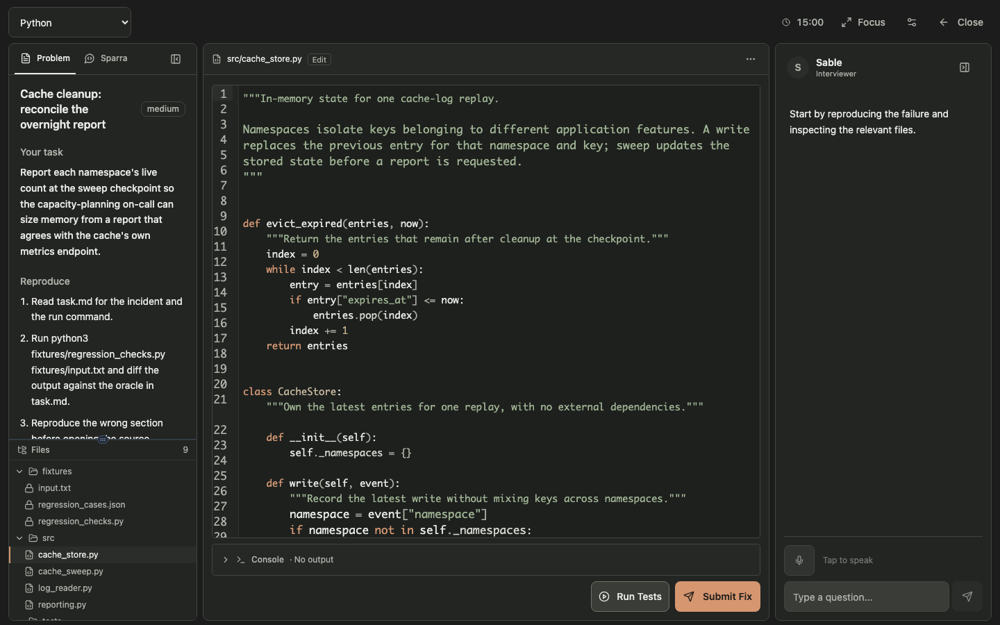
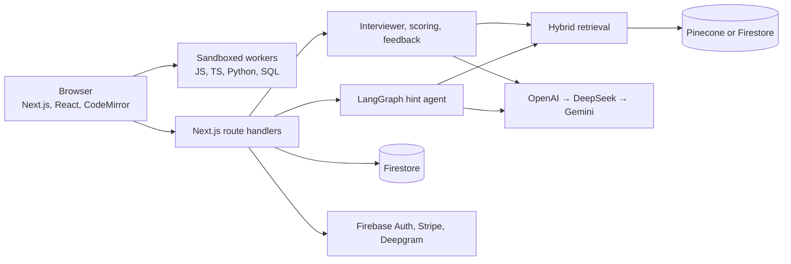

<p align="center">
  
</p>

<p align="center">
  <strong>Practice the interview rounds LeetCode skips, with an AI interviewer that watches you work.</strong>
</p>

<p align="center">
  <a href="https://www.codesparring.dev">Live site</a> •
  <a href="https://www.codesparring.dev/interview?track=debugging">Try a debugging round</a> •
  <a href="#benchmark">Benchmark</a> •
  <a href="docs/ARCHITECTURE.md">Architecture</a>
</p>



CodeSparring runs mock technical interviews in the browser. You get a real multi-file codebase or a
DSA problem, executable tests, an AI interviewer who can see your edits and test runs, and feedback
tied to what you did. Free courses, case labs, study roadmaps, and spaced repetition sit around it.

## Engineering highlights

| Area | How it works | Start reading |
| --- | --- | --- |
| **AI interviewer** | Grounds each turn in structured session state (phase, code, test runs), checks replies against interview rules, and regenerates violations | [`lib/interview/chat`](lib/interview/chat) |
| **Evidence-based scoring** | A root-cause score counts as observed only when its quote appears in something the candidate said | [`lib/bugfix`](lib/bugfix), [measurement contracts](docs/measurement-contracts.md) |
| **Hint agent** | LangGraph workflow: the LLM diagnoses the need, TypeScript controls which hints are allowed | [`lib/agents/hints`](lib/agents/hints) |
| **Retrieval** | DSA rounds use semantic search plus BM25 with reranking; an offline script reports Precision@K, Recall@K, and MRR | [`lib/rag`](lib/rag), [`scripts/eval-rag.ts`](scripts/eval-rag.ts) |
| **Model routing** | One table routes tasks by reasoning effort, with an OpenAI → DeepSeek → Gemini fallback chain | [`lib/ai-providers.ts`](lib/ai-providers.ts) |
| **In-browser execution** | JavaScript, TypeScript, Python, and SQL run client-side in sandboxed workers | [`lib/workspace-execution`](lib/workspace-execution) |
| **Review scheduling** | FSRS and SM-2 schedulers behind one router | [`lib/spaced-repetition`](lib/spaced-repetition) |

## Benchmark

[`benchmarks/codesparring`](benchmarks/codesparring) asks whether an AI tutor can give a useful,
grounded hint **without** leaking the answer or inventing bugs in correct code.

| Measured in v0.1.1 | Result |
| --- | ---: |
| Tasks (10 DSA, 10 bugfix) | 20 |
| Learner states / hint requests | 70 / 210 |
| Reference cases passing | 1,179 / 1,179 |
| Deliberately wrong programs rejected | 80 / 80 |
| Wrong programs the original public tests missed | **23 / 80** |

**Status:** the fixtures are verified, but no model responses have been scored yet. The 23 of 80
result describes these authored programs and is not a general grading-accuracy estimate. See the
[QA report](benchmarks/codesparring/reports/qa.md) and [design](docs/benchmarks/codesparring-v0.md).

```bash
pnpm benchmark:test
pnpm benchmark:verify
```

## Architecture



Code runs in the browser. The server-side Piston route (`/api/execute`) is deprecated and remains
only for one case-lab station.

**Stack:** Next.js 16, React 19, TypeScript 5, Tailwind CSS 4, Firebase, LangGraph, Pinecone, Vitest,
Playwright, Vercel.

## Run it locally

You need Node.js 22, pnpm, a Firebase project, and at least one AI provider key.

```bash
git clone https://github.com/Nikayel/MockmateWebsite.git
cd MockmateWebsite
pnpm install
cp .env.example .env.local   # then fill in your own credentials
pnpm dev                     # http://localhost:3000
```

Check a change before opening a PR:

```bash
pnpm lint && pnpm typecheck && pnpm test
```

## Repository map

| Path | Contents |
| --- | --- |
| `app/` | Pages and route handlers |
| `components/` | UI, with shared primitives in `components/ui` |
| `lib/` | Interview, AI, retrieval, scoring, and scheduling logic |
| `packs/` | Authored debugging incidents and their test oracles |
| `benchmarks/` | Hint benchmark, fixtures, and reports |
| `docs/` | Architecture, design decisions, and specifications |

More: [onboarding](docs/ONBOARDING.md) · [API](docs/API.md) · [database](docs/FIREBASE_STRUCTURE.md) ·
[testing](docs/TESTING_GUIDE.md) · [contributing](CONTRIBUTING.md) · [security](SECURITY.md)

## License

Proprietary. All rights reserved.
